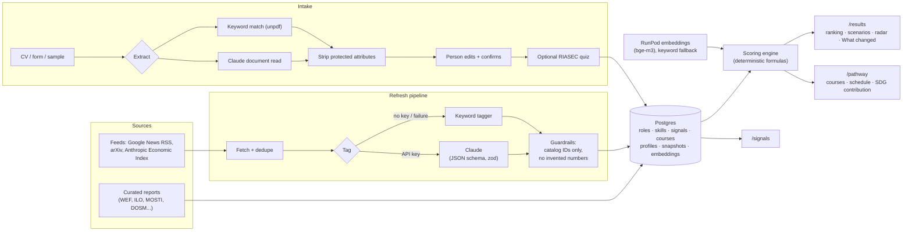

# LaluanKu: Future-Ready Career Navigator

> SDC Hackathon 2026 · Domain 1 (Aiversecity Future-Ready Workforce) · Team KitaHack

LaluanKu ("my path") is a living career forecast for Malaysians whose jobs are being reshaped by AI. It tracks dated trend signals, ranks future roles for a person's skills and interests with an explainable score, shows what changed when new signals arrive, and builds a free or low-cost learning pathway linked to the UN Sustainable Development Goals.

- **Live demo:** _Replit URL to be added after deployment_ · **Health check:** `/api/health`
- **Try it:** open `/results` for the sample persona Siti, or `/intake` to build your own profile. The site works in English and Bahasa Melayu.

---

## Problem

AI is changing Malaysian jobs faster than people are being trained for them:

- **56%** of professionals in Malaysia already use AI tools at work, but only **26%** have had any formal training, and **46%** hold back for lack of understanding or support ([Hays Asia Salary Guide 2025](https://sea.peoplemattersglobal.com/article/strategic-hr/ai-in-malaysian-workplaces-a-strategic-outlook-46436), as reported by People Matters; coverage differs on whether the 26% is out of all professionals or only AI users).
- **600,000+** workers must reskill within three to five years, and more than 30% of jobs in Malaysia will be affected by AI within ten years ([MOSTI, via Malay Mail, 7 Jan 2025](https://www.malaymail.com/news/malaysia/2025/01/07/mosti-ai-disruption-looms-in-malaysia-600000-workers-must-reskill-in-three-to-five-years/162368); see also the [MOHR–TalentCorp study](https://bernama.com/en/general/news.php?id=2350085)).
- Clerical and secretarial roles face the largest absolute declines worldwide, and clerical work is the most exposed to generative AI ([WEF Future of Jobs Report 2025](https://www.weforum.org/publications/the-future-of-jobs-report-2025/), [ILO Working Paper 140](https://www.ilo.org/publications/generative-ai-and-jobs-refined-global-index-occupational-exposure)).

People in these roles get generic advice, not a forecast they can trust or a plan they can afford. LaluanKu targets SDG targets **4.3** (affordable technical and vocational learning), **4.4** (relevant skills for decent jobs), **8.2** (productivity through innovation) and **8.5** (full and productive employment).

## User

**Primary user:** a mid-career admin or clerical worker in Malaysia whose role is flagged as declining. The moment of need is a restructuring notice, or returning to work after a career break.

**Demo persona (synthetic):** *Siti*, an administrative assistant with six years of experience, returning to work after four years of caregiving. She has about 8 hours a week to study and prefers free or HRD Corp-claimable courses. Two more synthetic samples show the range: *Aiman*, a marketing fresh graduate, and *Daniel*, an E&E production technician.

**Later users:** career switchers and fresh graduates, HR and L&D teams planning reskilling, and TVET and university career centres.

## Solution

```
Profile  →  trend signals  →  scenario-weighted ranking  →  what changed  →  learning pathway + SDG contribution
```

1. **Build a profile in minutes** (`/intake`): upload a CV, fill a short form, or start from a sample. Skills are mapped to our catalog, protected attributes are stripped, and the person edits and confirms every skill. An optional 18-question RIASEC interest quiz (EN/BM) adds interest fit.
2. **Read the signals** (`/signals`): 36 curated, dated signals from reports such as WEF, ILO, the Anthropic Economic Index, MOSTI and DOSM, plus fresh items pulled from news, research and dataset feeds and tagged against our catalog.
3. **See ranked future roles** (`/results`): every score is a visible formula of skill match, signal-driven demand and interest fit, with the signals behind it (source and date), a confidence band and an *Estimate, not a prediction* label. A **scenario toggle** (moderate or fast AI disruption) and **weight sliders** re-rank the roles live, and the Future Skills Radar shows rising and declining roles and skills.
4. **Watch the forecast move** ("What changed"): after new signals arrive, the page shows how the ranking moved and why. For example: *"Your #2 role, Vocational & Digital Skills Trainer, moved up from #6 because of 13 new signals since 20 Oct 2026."*
5. **Get a plan** (`/pathway/[role]`): an ordered set of real courses from a checked catalog of 46, within the person's budget and weekly hours, with total time, a weekly schedule, honest gaps, alternatives, and the path's SDG contribution.

**What makes it different:** the forecast is living and traceable. Every number links to a dated source, scores come from published formulas rather than an AI's opinion, rankings visibly change when the data changes, and the person stays in control of skills, weights, scenarios and course choices.

### Three-minute demo

1. `/results?profile=siti-admin-returner`: the top three roles, the formula, the skills gap and cited signals. Toggle *Fast AI disruption* and watch the order change.
2. `/signals` → enter the admin token → *Refresh signals*. New items arrive and are tagged.
3. Back on `/results`: the **What changed** panel explains the move.
4. Click *See my learning pathway* on a role: courses, weeks, cost and the SDG contribution.
5. Switch to **BM** in the header; open `/about` for the AI disclosure and fairness approach.

## Must-have checklist

| # | Must-have | Where it lives | How it meets the brief |
|---|---|---|---|
| 1 | Skills profile intake | `/intake`, `lib/intake/`, `lib/riasec.ts` | CV (PDF), form or sample; Claude extraction with keyword fallback; editable, confirmed skills; optional RIASEC quiz for "potential" |
| 2 | AI-trend signal layer | `/signals`, `POST /api/signals/refresh`, `lib/signals/` | Updatable feeds (Google News RSS, arXiv, Anthropic Economic Index dataset) on top of curated reports; every signal shows source, published date and fetch date |
| 3 | Future-role matching | `/results`, `lib/scoring/`, `lib/embeddings.ts` | Ranked roles, explainable formula, confidence band, skills gap, cited signals; multilingual embeddings (RunPod) with keyword fallback |
| 4 | Personalised pathway | `/pathway/[roleId]`, `lib/pathway/`, `seed/courses.json` | Ordered plan from checked free, low-cost and HRD Corp-claimable courses, with estimated hours, weeks and a weekly schedule |
| 5 | SDG mapping | SDG chips on `/results`, SDG section on `/pathway`, `lib/sdg.ts` | Every role and skill is tagged to SDGs and targets with a reason; each path shows its contribution to 4.3, 4.4, 8.2, 8.5 and the role's targets |
| 6 | Handling uncertainty | `/results` | Moderate and fast-AI scenarios, confidence bands, "Estimate, not a prediction" labels, documented modelling choices |

Success criteria: profile to ranked roles to pathway in minutes; every recommendation shows its source; output **visibly changes when trend data changes** (the What changed panel); the SDG link is computed for the specific path.

## Architecture



**Stack:** Next.js 16 (App Router, Cache Components) + TypeScript + Tailwind 4 · Postgres + Drizzle ORM (PGlite for local development and tests) · Claude API (`@anthropic-ai/sdk`) · RunPod Serverless embeddings · deployed on Replit.

**Data model** (`lib/db/schema.ts`): `skills`, `roles` (with SDG targets, AI exposure and O*NET RIASEC profile), `role_skills`, `signals`, `scenarios`, `courses`, `profiles`, `ranking_snapshots`, `feed_items` and `signal_refresh_runs` (the audit trail), and `skill_embeddings` (the cache).

### Trend signal layer

- **Baseline:** 36 curated signals from dated, source-checked reports and news. Sources, dates, strength rubric and editorial choices are in [seed/README.md](seed/README.md).
- **Updatable feeds** (`lib/signals/feeds.ts`): Google News RSS searches on AI and jobs, green jobs, the care workforce and talent policy in Malaysia; arXiv research on generative AI and labour markets; and new release folders in the [Anthropic Economic Index dataset](https://huggingface.co/datasets/Anthropic/EconomicIndex).
- **Refresh** (admin button on `/signals`, `POST /api/signals/refresh` with `Authorization: Bearer $ADMIN_TOKEN`, or `npm run signals:refresh`): fetch feeds, drop items already seen or near-duplicates, tag the rest, apply guardrails, then re-snapshot rankings.
- **Tagging:** Claude decides relevance and direction, links each item **only to role and skill IDs from our catalog**, and summarises using facts from the item alone. Its JSON-schema output is zod-validated and retried once. Without credentials, a deterministic keyword tagger takes over, and every signal shows which method tagged it.
- **Guardrails** (`lib/signals/guardrails.ts`): unknown IDs are dropped; items with no valid link are rejected; a summary with a number not in the source is replaced by the headline; feed items are capped at strength 3.
- **Audit trail:** every checked item is stored in `feed_items` with a status and reason, and every run in `signal_refresh_runs` with per-feed status. If feeds fail, existing signals stay and the page shows the last good fetch.

### Scoring (deterministic; constants in `lib/scoring/config.ts`)

- **Signal contribution** = ±strength × 0.5^(age in days / 365). A signal counts in full when it names the role, and at 0.5 × importance / 3 when it names one of the role's required skills. Skill-level signals add at most ±2 per role, and feed signals naming a role add at most ±3, so a burst of similar news can't outweigh the curated reports.
- **Role demand** = Σ contributions × scenario multiplier, where multiplier = 1 + (m − 1) × AI-exposure weight (low 0, medium 0.5, high 1; m = 1.0 for moderate, 1.5 for fast AI). It is mapped to 0–100 with 50 + 50·tanh(raw / 5), so 50 means no net signal.
- **Skill match** = the importance-weighted share of the role's required skills the person has. A related skill counts when similarity reaches the threshold, and the UI says which skill covered it. Similarity is the cosine of `BAAI/bge-m3` embeddings from RunPod (threshold 0.8, cached), or keyword overlap (threshold 0.5) as the fallback.
- **Interest fit** = cosine similarity of the person's and the role's mean-centred RIASEC profiles (O*NET data).
- **Final** = 0.45 × skill + 0.35 × demand + 0.20 × interest, or 0.55 × skill + 0.45 × demand without the quiz. The person can change the weights.
- **Confidence** (low, medium or high, from signal count and agreement) sets a ± band on demand.
- Emerging roles are ranked by default. Declining roles that match the person's current skills are shown separately, and can be included in the ranking.

### Living forecast: "What changed"

- The **signals version** is a hash of every signal's id, direction, strength, date and links.
- **Ranking snapshots** store a profile's ranking per scenario and signals version. The refresh pipeline (`lib/refresh-pipeline.ts`) snapshots tracked profiles before and after new signals arrive; `/results` diffs against the latest snapshot on a different version and explains the biggest move with the new signals behind it.

### Learning pathway

- **Courses come only from the checked catalog** (`seed/courses.json`: 46 courses from Kaggle, Cisco, Microsoft Learn, UiPath, HubSpot, Anthropic, GitHub, Canva, freeCodeCamp, Harvard, Helsinki, GHG Protocol, Coursera and edX universities, and a SEDA solar course at Pahang Skills). Each has a URL, provider, cost, hours and a check date; estimated hours are flagged with `*`.
- **Selection** (`lib/pathway/engine.ts`): a greedy cover of the skills gap within budget (importance / √hours, free and shorter first). It never picks a course only for a human skill; those go under *Build through practice*.
- **Order:** most important gap first, quick wins before long courses, prerequisites first. **Schedule:** back to back at the person's weekly hours.
- **Honest gaps:** *Possible if your budget allows*, *Not in our catalog yet*, and up to two alternatives per step.
- **SDG contribution:** reasons specific to the path for 4.4, 4.3, 8.5, 8.2 and the role's own targets.

### Intake, fairness and privacy

- **CV upload:** PDF only, up to 5 MB, checked by type and `%PDF-` signature. The file is read in memory, sent to Claude as a document block (skill slugs constrained to the catalog), then discarded. It is never stored or logged. Without credentials, keyword matching over the PDF text takes over.
- **Protected attributes:** age, gender, ethnicity, religion, marital status, place of origin, IDs and contact details are forbidden in the prompt and stripped from every text field (`lib/intake/sanitize.ts`) before review and again before saving. They are never scoring inputs.
- **Fairness test** (`lib/fairness.test.ts`): three synthetic CVs that differ only in those attributes go through extraction, sanitising and scoring, and must yield identical skills, no protected text, and identical rankings under every scenario.
- **Human in the loop:** the person confirms every skill, can change weights and scenarios, can skip the quiz, and chooses courses. The interest quiz never hides a role.
- **Privacy:** saved profiles use an unguessable link, uploads and saves are rate-limited, and sample profiles are fictional.

### Language and accessibility

- **EN/BM switch** in the header (cookie-based) for every page. `lib/i18n.ts` is typed so every English string has a Bahasa Melayu version. Catalog data (role and skill names) is in English.
- Mobile first: checked at 375 px with no horizontal scrolling; labelled form controls; SDG chips in official colours with readable contrast.

### Repository map

| Path | What's there |
|---|---|
| `app/` | Pages (`/`, `/intake`, `/results`, `/pathway/[roleId]`, `/signals`, `/about`) and API routes (`/api/intake/cv`, `/api/profiles`, `/api/signals/refresh`, `/api/health`) |
| `lib/signals/` | Feeds, fetching, Claude and keyword taggers, guardrails, refresh |
| `lib/scoring/` | Engine, scoring context, snapshots and diff, results loader |
| `lib/pathway/` | Pathway engine and loader |
| `lib/intake/` | CV extraction, sanitiser, schemas |
| `lib/embeddings.ts`, `lib/runpod.ts` | Skill similarity (RunPod embeddings with keyword fallback) |
| `lib/riasec.ts`, `lib/sdg.ts`, `lib/i18n.ts` | Interest quiz, SDG metadata, EN/BM strings |
| `seed/` | Curated roles, skills, signals, scenarios, courses and synthetic profiles ([seed/README.md](seed/README.md)) |
| `drizzle/` | SQL migrations |
| `scripts/` | Seed, local database, refresh, checks, embedding tools, production migrate |
| `docs/runpod.md` | RunPod endpoint setup and proof checklist |

## Hardest risk + fallback

**The hardest risk is trusting the trend data and the AI with people's career decisions.** If signals are noisy or the AI invents things, the forecast misleads the very people it is meant to help. Every layer has a fallback:

| Risk | What we built |
|---|---|
| Unreliable or noisy trend data | 36 curated, dated, source-checked signals as the baseline. Feed items are capped (strength ≤ 3, ±3 per role), near-duplicates are dropped, and every checked item is logged with a reason. If every feed fails, existing signals stay and `/signals` shows the last good fetch. |
| AI inventing jobs, courses or statistics | Roles, skills and courses come only from database tables. Claude's output is schema-constrained (catalog enums), zod-validated, and unknown IDs are dropped. Summaries with numbers not in the source are replaced by the headline. |
| Claude unavailable (no key, outage, refusal) | Keyword taggers for signals and CVs keep everything working, and the UI shows which method was used. Requests opt into server-side refusal fallback. |
| Matching quality | The person confirms every skill. Related-skill matching uses multilingual embeddings with a tunable threshold (`npm run embeddings:check`). |
| RunPod downtime or cold starts | Skill vectors are cached in the database, so page views don't call RunPod. On failure or timeout, matching falls back to keyword overlap and RunPod is skipped for 5 minutes. |
| Bias against protected groups | Attributes are stripped and never used. An automated test proves identical rankings across names, genders, ethnicities and religions. |
| Demo-day infrastructure | `npm run db:local` runs Postgres in-process; `/api/health` checks the deployment; every external dependency has a fallback. |

## AI disclosure

| Model | Used for | Not used for |
|---|---|---|
| **Claude** (Anthropic API), model from `AI_MODEL`, default `claude-opus-5-5` | Tagging feed items against our catalog; extracting skills from an uploaded CV. Requests opt into server-side refusal fallback (`fallbacks: "default"`). | Scores, rankings, demand, pathway selection or order, and explanations. These are deterministic code and templates. |
| **BAAI/bge-m3** embeddings on RunPod Serverless (Infinity worker) | Comparing skill names to find related skills. | Anything else. Keyword overlap is the fallback. |

- Claude only selects from and labels our database records. It never invents jobs, courses or statistics, and every Claude output is validated before use. The models in use are also disclosed on `/about`, with their live status.
- **Development:** this codebase was built with help from Claude Code (Anthropic), as shown by the co-author lines in the commit history.
- **Data attribution:** role interest profiles include information from the [O*NET 31.0 Database](https://www.onetcenter.org/database.html) by the U.S. Department of Labor, Employment and Training Administration (USDOL/ETA), used under the [CC BY 4.0](https://creativecommons.org/licenses/by/4.0/) license. We mapped each role to its closest O*NET occupation and rescaled the scores. O*NET® is a trademark of USDOL/ETA.

## Sponsor tools

| Tool | How we use it | Proof |
|---|---|---|
| **Replit** | Hosts the app (Autoscale deployment) and its Postgres database. `.replit` defines build (`npm ci && npm run build`) and run (`npm run db:deploy && npm run start:replit`). | Live URL: _to be added after deployment_ |
| **RunPod** | Serverless GPU endpoint serving `BAAI/bge-m3` embeddings for skill matching ([docs/runpod.md](docs/runpod.md)). | Endpoint ID, GPU type and runtime screenshot, plus `npm run embeddings:check` output: _to be added after the endpoint is deployed_ |
| **GitHub** | Source, commit history (one commit per meaningful step), Apache License 2.0. | Repository made public and committee accounts added before submission |

## How to run

### Locally, without installing Postgres

```bash
npm install
npm run db:local   # terminal 1: local Postgres (PGlite) in .pglite/, migrated + seeded; creates .env.local if missing
npm run dev        # terminal 2, then open http://localhost:3000
```

Add `ANTHROPIC_API_KEY` to `.env.local` to use Claude; without it the keyword fallbacks are used. Keep `DATABASE_POOL_MAX=1` while using the local database. To use RunPod, follow [docs/runpod.md](docs/runpod.md).

### With your own Postgres

```bash
cp .env.example .env.local   # set DATABASE_URL, ADMIN_TOKEN, ANTHROPIC_API_KEY (and RunPod vars, optional)
npm install
npm run db:migrate
npm run db:seed
npm run dev
```

### Deploy on Replit

1. Import this GitHub repository into Replit from your own account.
2. Create the built-in **PostgreSQL** database (Tools → Database). This sets `DATABASE_URL`.
3. Add **Secrets**: `ANTHROPIC_API_KEY`, `AI_MODEL` (`claude-opus-5-5`), `ADMIN_TOKEN` (a long random string), and optionally `RUNPOD_ENDPOINT`, `RUNPOD_API_KEY`.
4. In the Shell run `npm ci`, then `npm run db:deploy` (migrate + seed). Press **Run** to try it.
5. Click **Deploy** and choose Autoscale; `.replit` supplies the build and run commands.
6. Open `/api/health` on the live URL: it should report `"ok": true` with 30 roles. Then run *Refresh signals* once from `/signals`.

`.replit` uses the `nodejs-22` and `postgresql-16` modules; if your workspace offers different names, pick the closest.

### Testing and checks

| Command | What it checks |
|---|---|
| `npm test` | 49 unit and integration tests: scoring engine, diff, pathway engine, RIASEC, sanitiser, RunPod client, embedding cache and fallback, and the fairness test |
| `npm run db:check` | Validates every seed file, then migrates and seeds an in-memory Postgres twice (idempotency) |
| `npm run results:check` | Prints each sample profile's ranking under both scenarios |
| `npm run signals:check` | Dry-runs a refresh against live feeds and shows how Siti's ranking would change |
| `npm run embeddings:check` | Embeds and caches skills via RunPod and prints the similarity distribution for tuning |
| `npm run lint`, `npm run build` | Lint and production build |

Other scripts: `db:generate` (new migration), `db:studio`, `signals:refresh`, `db:deploy`, `embeddings:mock` (local RunPod stand-in).

## Data and privacy

Public, open or synthetic data only: no real CVs or personal data. Sample profiles are fictional. Uploaded CVs are never stored. Seed data sources, verification dates and editorial judgements are documented in [seed/README.md](seed/README.md).

## Future work

- **Claude-written explanations, validated:** let Claude phrase "why this role" and suggest pathway sequencing, constrained to IDs and numbers already on the page and checked before display.
- **Richer, more local signals:** official labour-market datasets (for example DOSM and OpenDOSM), MyMahir and TalentCorp critical-occupation updates, and job-posting data where licensing allows; calibrate signal strengths with labour economists.
- **A bigger, more local catalog:** more roles (beyond 30), BM-language and HRD Corp-listed courses, TVET programmes, and course availability checked automatically.
- **Translated catalog data:** role and skill names in BM and Chinese, plus a Chinese UI.
- **Progress and accounts:** save a pathway, mark courses done and get a re-ranked forecast over time (optional, privacy-preserving).
- **Organisation views:** reskilling dashboards for HR, L&D and TVET or university career centres, using aggregated, anonymised data only.
- **Accessibility and evaluation:** a full accessibility audit, and user testing with returning workers in Malaysia.

## License

[Apache License 2.0](LICENSE) · Team KitaHack
